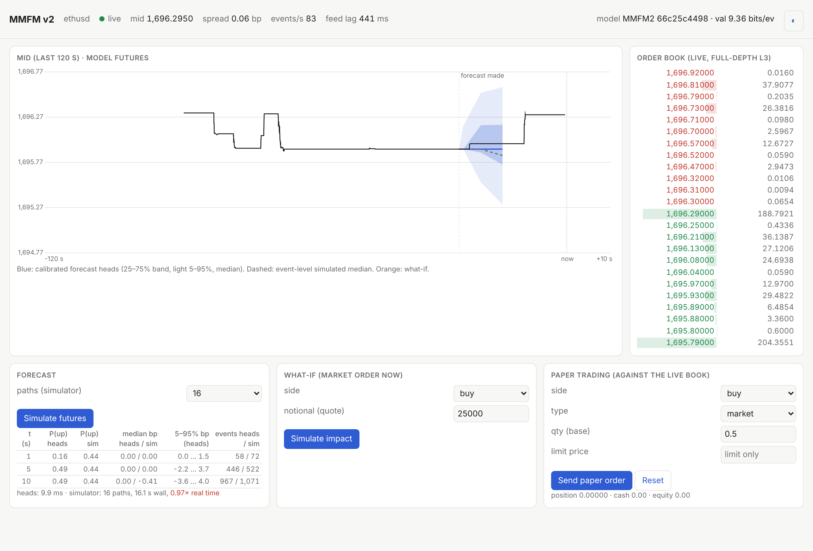

# MMFM — market-microstructure foundation model (pilot)

A state–event generative model of full-depth L3 order flow, trained on **real, public, live Bitstamp data**
and served through a minimal interface wired only to this model. It was built after the M3 audit
(`../m3repro`) and fixes each M3 flaw that the audit found:

| M3 flaw (audit) | MMFM design |
|---|---|
| VQ tokens are context-dependent (11.6-tick price drift) | Discrete, factorised tokens fit on train: act / side / bp-distance-from-touch / log-notional / Δt. The likelihood is exact. |
| The LOB is encoded once and goes stale | The state is recomputed from the verified book at **every event** (spread, imbalance, depth, returns, activity). |
| 10-level snapshot replay leaves phantom liquidity | Full-depth order-id reconstruction, **exact against every REST snapshot** (Jaccard 1.000). Cancels resolve against existing depth. |
| No rolling context in the release | A KV-cached rolling window, proven equal to the batch model. |
| Checkpoints were selected on test data | The test split is sealed and every access is logged. Selection uses val only. |

## Data (collect/recorder.py → data/l3.py → data/build.py)
* Bitstamp `live_orders` + `live_trades` for 8 pairs (≈750 events/s), plus order-id REST snapshots every 5 min.
* Each segment is anchored on a snapshot taken **after** the subscription; REST snapshots can be served stale by seconds.
* Bitstamp quirks found by verification and pinned by `tests/test_l3.py`:
  * trades on another channel arrive before the taker's `order_created`;
  * an aggressive `order_created` carries the full amount;
  * `order_changed` during a fill reports the execution price;
  * a delete message carries the unfilled amount;
  * trades can be stamped 1 ms after the order;
  * float-dust levels;
  * truncated gzip members.

## Evaluation & leakage protocol — `EVAL.md`, committed before training
* Splits by wall-clock time: 70 / 10 / 20, with a 10-min embargo.
* **linkusd is a held-out pair** (zero-shot).
* The test split is sealed: one unseal per (model hash, split, pre-registered metric), and each one is logged.
* Development data must fall inside the final train region (addendum 1). This is enforced in code.
* Baselines are fit on train with the identical tokenisation:
  * B0 zero-intelligence;
  * B1 Markov;
  * **B2 feature MLP**, the realistic bar. It gets the same tuning budget as MMFM.
* Metrics:
  * M1 next-event NLL (bits/event, block-bootstrap CIs);
  * M2 simulation realism (PIT, CRPS, W1, event rate);
  * M3 P(up);
  * M5 CPU latency / real-time factor;
  * M6 reconstruction fidelity.

## Harness (`pytest tests/`)
* Causality: AR model, features and KV cache.
* **Train/serve skew**: replayed recorded messages through the live handler give tokens and features identical to training.
* Seal and held-out isolation.
* AST scan: training code never names a sealed split.
* Tokenizer provenance.
* The incremental path equals the batch path.

The harness caught two of my own leaks before any training:
* a feature that used the *next* event's Δt;
* a live/batch skew in the definition of "state after the event".

## Interface — `serve/app.py` (+ `serve/index.html`, no external deps)
```bash
python3 -I serve/app.py --run runs/final_mmfm --pair ethusd --port 8765
```
Then open http://127.0.0.1:8765. It shows:
* the live L3 book and the feed lag;
* simulated futures (fan chart, P(up), real-time factor);
* a paired what-if for a market order;
* **paper trading** against the live displayed depth: market orders take VWAP across levels, and limit orders queue behind the displayed depth.

**No real orders can be sent.** Moving to real execution needs exchange keys, a risk layer and your explicit decision.


## Verdict (qualitative; all numbers are in the generated block below)
* **Next-event prediction (M1): MMFM wins on the sealed test** against every baseline, including a tuned feature MLP
  given the same budget. The 95% CI of the gap excludes 0, which meets the pre-registered criterion.
* **Zero-shot transfer to an unseen pair: MMFM loses** to the feature MLP, and every model is much worse than in-distribution.
  The "foundation" claim is **not** supported at this scale.
* **Simulation realism (M2): MMFM is not better than trivial count generators.** Multi-step paths are under-dispersed at
  5–10 s, and MMFM over-generates events. Better one-step likelihood did not give calibrated multi-step simulation.
  Exposure bias and the Δt head are the prime suspects.
* **Real-time (M5)**: live updates take milliseconds, but multi-path rollouts are slower than the market on BTC/ETH.
* **Data (M6)**: the reconstruction is exact against every verification snapshot.
* Process: six logged test unseals, each tied to an EVAL addendum committed before it.
  Addenda 4 and 5 fixed defects in *my* evaluation code after the first unseal; originals are kept.

## Results
<!-- AUTO:results -->
Frozen splits (wall clock): train 97 min · val 5 min · test 31 min · embargo 10 min · held-out pair `linkusd` · files hash `06cf74d60276`

**M6 data fidelity**: 227/227 snapshot verifications accepted (mean order-id Jaccard 1.0000); 6,436,369 model events in used segments.

**M1 val (selection split; 5-min block CIs)** — 39,879 scored events, 633 tiles (T=64)

| model | bits/event | 95% CI | Δ vs best baseline [95% CI] |
|---|---|---|---|
| B0_zero_intelligence | 15.161 | [15.111, 15.261] |  |
| B1_markov | 13.453 | [12.821, 14.219] |  |
| final_mmfm:MMFM | 9.383 | [8.330, 10.629] | -0.613 [-0.744, -0.527] vs final_b2 |
| final_b2:FeatMLP | 9.996 | [8.865, 11.322] |  |

**M1 TEST (sealed; CIs recomputed with 5-min blocks, addendum 4)** — 39,123 scored events, 621 tiles (T=64)

| model | bits/event | 95% CI | Δ vs best baseline [95% CI] |
|---|---|---|---|
| B0_zero_intelligence | 15.208 | [15.170, 15.255] |  |
| B1_markov | 13.666 | [13.305, 14.083] |  |
| final_mmfm:MMFM | 9.356 | [8.794, 10.046] | -0.612 [-0.682, -0.553] vs final_b2 |
| final_b2:FeatMLP | 9.968 | [9.369, 10.699] |  |

**M1 held-out pair linkusd, test period (zero-shot; addendum-4 CIs)** — 31,626 scored events, 502 tiles (T=64)

| model | bits/event | 95% CI | Δ vs best baseline [95% CI] |
|---|---|---|---|
| B0_zero_intelligence | 15.670 | [15.637, 15.703] |  |
| B1_markov | 15.371 | [15.303, 15.447] |  |
| final_mmfm:MMFM | 13.442 | [13.303, 13.569] | +0.299 [+0.271, +0.337] vs final_b2 |
| final_b2:FeatMLP | 13.143 | [13.018, 13.240] |  |

Original (defective, 20k-event-block) test CI for MMFM−B2: [-0.660, -0.564] — kept for the record.

**M2/M3 simulation realism, test** (addendum-5 metrics; start points = exact book checkpoints; lower CRPS/W1 better; PIT mean 0.5, central-80 coverage 0.8 and event-count ratio 1.0 ideal)

| pair | generator | h (s) | n | PIT mean | in central 80% | CRPS bp | W1 bp | Brier P(up) | event ratio |
|---|---|---|---|---|---|---|---|---|---|
| ethusd | MMFM | 1.0 | 15 | 0.39 | 0.87 | 0.110 | 0.099 | 0.047 | 2.08 |
| ethusd | MMFM | 5.0 | 15 | 0.38 | 0.40 | 1.225 | 1.038 | 0.217 | 1.54 |
| ethusd | MMFM | 10.0 | 15 | 0.27 | 0.27 | 0.974 | 0.879 | 0.220 | 2.21 |
| ethusd | B1 | 1.0 | 15 | 0.56 | 0.93 | 0.105 | 0.089 | 0.026 | 1.88 |
| ethusd | B1 | 5.0 | 15 | 0.40 | 0.27 | 1.248 | 1.100 | 0.175 | 1.10 |
| ethusd | B1 | 10.0 | 15 | 0.26 | 0.20 | 1.038 | 0.944 | 0.154 | 1.20 |
| ethusd | B0 | 1.0 | 15 | 0.54 | 0.93 | 0.147 | 0.183 | 0.214 | 1.89 |
| ethusd | B0 | 5.0 | 15 | 0.38 | 0.20 | 1.292 | 1.027 | 0.349 | 1.18 |
| ethusd | B0 | 10.0 | 15 | 0.26 | 0.20 | 1.086 | 0.919 | 0.281 | 1.20 |
| xrpusd | MMFM | 1.0 | 15 | 0.49 | 0.80 | 0.275 | 0.219 | 0.230 | 2.25 |
| xrpusd | MMFM | 5.0 | 15 | 0.59 | 0.67 | 0.788 | 0.331 | 0.325 | 2.16 |
| xrpusd | MMFM | 10.0 | 15 | 0.57 | 0.67 | 0.928 | 0.422 | 0.242 | 2.39 |
| xrpusd | B1 | 1.0 | 15 | 0.54 | 0.93 | 0.302 | 0.199 | 0.570 | 1.93 |
| xrpusd | B1 | 5.0 | 15 | 0.53 | 0.73 | 0.663 | 0.224 | 0.283 | 1.40 |
| xrpusd | B1 | 10.0 | 15 | 0.47 | 0.73 | 0.810 | 0.414 | 0.258 | 1.39 |
| xrpusd | B0 | 1.0 | 15 | 0.50 | 0.80 | 0.279 | 0.171 | 0.281 | 1.75 |
| xrpusd | B0 | 5.0 | 15 | 0.53 | 0.53 | 0.662 | 0.262 | 0.245 | 1.28 |
| xrpusd | B0 | 10.0 | 15 | 0.44 | 0.60 | 0.887 | 0.555 | 0.276 | 1.40 |
| dogeusd | MMFM | 1.0 | 15 | 0.60 | 0.87 | 0.102 | 0.290 | 0.102 | 10.88 |
| dogeusd | MMFM | 5.0 | 15 | 0.62 | 0.80 | 0.708 | 0.512 | 0.239 | 8.25 |
| dogeusd | MMFM | 10.0 | 15 | 0.68 | 0.60 | 1.096 | 0.778 | 0.311 | 9.91 |
| dogeusd | B1 | 1.0 | 15 | 0.60 | 1.00 | 0.181 | 0.394 | 0.078 | 12.92 |
| dogeusd | B1 | 5.0 | 15 | 0.52 | 0.87 | 0.487 | 0.394 | 0.205 | 5.26 |
| dogeusd | B1 | 10.0 | 15 | 0.62 | 0.53 | 0.909 | 0.537 | 0.204 | 4.63 |
| dogeusd | B0 | 1.0 | 15 | 0.66 | 1.00 | 0.210 | 0.472 | 0.203 | 16.08 |
| dogeusd | B0 | 5.0 | 15 | 0.45 | 0.87 | 0.610 | 0.397 | 0.172 | 6.77 |
| dogeusd | B0 | 10.0 | 15 | 0.47 | 0.67 | 1.061 | 0.409 | 0.243 | 5.94 |

**M5 real-time (CPU, 4 threads, 839,909 params)**: live update p50 2.05 ms, p99 4.26 ms.

| paths | ms/step | sim events/path/s | real-time factor vs median rate (per pair) |
|---|---|---|---|
| 1 | 2.9 | 342 | btceur 4.54×, btcusd 1.32×, dogeusd 7.73×, ethusd 2.21×, ltcusd 18.91×, solusd 3.89×, xrpusd 3.24× |
| 8 | 8.1 | 123 | btceur 1.63×, btcusd 0.47×, dogeusd 2.77×, ethusd 0.79×, ltcusd 6.79×, solusd 1.39×, xrpusd 1.16× |
| 16 | 12.3 | 81 | btceur 1.08×, btcusd 0.31×, dogeusd 1.83×, ethusd 0.52×, ltcusd 4.48×, solusd 0.92×, xrpusd 0.77× |
| 32 | 21.9 | 46 | btceur 0.61×, btcusd 0.18×, dogeusd 1.03×, ethusd 0.30×, ltcusd 2.52×, solusd 0.52×, xrpusd 0.43× |

Test access log (every unseal):

```
{"model_hash": "0fd55e8ebc15825c9f7c7cf6e2c16875837516e8090345b241a83a2959eb56d3", "split": "test", "purpose": "M1", "utc": "2026-11-26T06:12:27Z"}
{"model_hash": "0fd55e8ebc15825c9f7c7cf6e2c16875837516e8090345b241a83a2959eb56d3", "split": "heldout_test", "purpose": "M1", "utc": "2026-11-26T06:12:55Z"}
{"model_hash": "0fd55e8ebc15825c9f7c7cf6e2c16875837516e8090345b241a83a2959eb56d3", "split": "test", "purpose": "M2", "utc": "2026-11-26T06:13:59Z"}
{"model_hash": "0fd55e8ebc15825c9f7c7cf6e2c16875837516e8090345b241a83a2959eb56d3", "split": "test", "purpose": "M1-CI", "utc": "2026-11-26T06:54:26Z"}
{"model_hash": "0fd55e8ebc15825c9f7c7cf6e2c16875837516e8090345b241a83a2959eb56d3", "split": "heldout_test", "purpose": "M1-CI", "utc": "2026-11-26T06:54:54Z"}
{"model_hash": "0fd55e8ebc15825c9f7c7cf6e2c16875837516e8090345b241a83a2959eb56d3", "split": "test", "purpose": "M2-fix", "utc": "2026-11-26T06:55:42Z"}
```
<!-- /AUTO:results -->

## Known limitations (measured, not hidden)
* **Compute**: CPU only, about 1M parameters, about 2.5 h of data. This is a pilot, not a foundation-scale model.
* **Real-time**: event-level rollouts cost about 8–21 ms per step for 16 paths. On fast pairs the simulator is
  slower than the market (dev: 0.3–0.5× real time), so live forecasts are limited to seconds.
* **Simulation calibration (dev)**: rollouts generate about 2× too many events, and the forecast fan is too narrow.
  Better next-event NLL does not imply calibrated multi-step paths.
* **Event extraction**: the model-event stream reproduces the order-id book exactly on slower pairs. On BTC/ETH/XRP
  a small residue accumulates: top-50 level match is 86–100% after 0.4–0.8M events. Model state always
  comes from the exact order-id book.

## v2 — what changed and what the forward test says

Protocol: `EVAL_v2.md` (criteria fixed before training) + addenda v2-1 (data exclusion), v2-2/2a (anchored
simulator clock, decided on val), v2-3 (forward build memory fix; no forward data was built before it).
Frozen bundle: `FROZEN_v2.json` (sha256 of MMFM-v2, B2-v2, tokenizer, simulator calibration). Forward window:
2026-11-26 20:35:25–22:05:25 UTC, recorded after the freeze, unsealed exactly once per metric (access log below).

v2 changes vs v1: state-relative size tokens (a cancel/take is a fraction of the level it hits, with exact
whole-level bins); monotone-clock features; direct forecast heads for R_h and N_h (h = 1, 5, 10 s), temperature-
calibrated on val; KV-cache re-prefill bug fixed; simulator clock anchored on the count heads (free-running
clock over-generated 2–3.6× on val, at 1 s already).

Verdict (forward test, numbers in the generated block):
* **Next-event NLL: MMFM-v2 beats the tuned feature MLP B2-v2** by about 0.48 bits/event, and the CI excludes 0
  (criterion 5 met; the val gap was 0.63).
* **Zero-shot linkusd NLL: MMFM-v2 is slightly worse than B2-v2** (+0.07 bits/event, CI excludes 0). Criterion 6
  is not met, so a "foundation" transfer claim is still not supported at this scale. The gap shrank from +0.30 in v1.
* **Simulator, criteria 1–4: not met.**
  * Event counts are much closer than v1's free-running clock, but the forward window was 7–28% quieter than the
    design data (post-hoc diagnostic). The count heads over-predicted by 1.1–1.6×, so only 3/9 cells fall in [0.8, 1.25].
  * Coverage80 is in range in 6/9 cells and PIT in 5/9.
  * CRPS beats the best count baseline in only 1/9 cells.
* **The direct heads beat the MMFM simulator on CRPS in 9/9 cells**, in about 2.5 ms, but beat the best count
  baseline in only 4/9. Event-level simulation is for what-ifs and paths; it is not yet a better
  distributional forecaster than empirical count generators.
* **Real time: met.** 8 paths on ETH run at 2.6× the median market event rate, and 16 paths at about 1× in the live UI.
* **Not shown:** the model makes no trading-profitability claim, and no real orders can be sent. Deployment
  would need a calibration monitor for regime shifts in activity. That monitor is the main measured failure mode.



```bash
python3 -I serve/app2.py --run runs/v2 --pair ethusd --port 8766   # reads frozen sim_calibration.json
```

## v2 results (generated)
<!-- AUTO:v2 -->
**M1 next-event NLL — FORWARD test** — 96,957 events, 131 five-minute blocks

| model | bits/event | 95% CI |
|---|---|---|
| B0 | 14.334 | [14.273, 14.393] |
| B1 | 12.415 | [12.275, 12.573] |
| MMFM-v2 | 9.013 | [8.601, 9.468] |
| B2-v2 | 9.491 | [9.070, 9.960] |

MMFM-v2 − B2-v2: -0.478 bits/event, 95% CI [-0.504, -0.454]

**M1 zero-shot linkusd — FORWARD test** — 105,840 events, 19 five-minute blocks

| model | bits/event | 95% CI |
|---|---|---|
| B0 | 13.904 | [13.881, 13.929] |
| B1 | 13.034 | [12.978, 13.087] |
| MMFM-v2 | 11.765 | [11.602, 11.897] |
| B2-v2 | 11.692 | [11.539, 11.821] |

MMFM-v2 − B2-v2: +0.073 bits/event, 95% CI [+0.053, +0.094]

**M1 next-event NLL — v2 val (selection)** — 103,509 events, 40 five-minute blocks

| model | bits/event | 95% CI |
|---|---|---|
| B0 | 14.149 | [14.090, 14.212] |
| B1 | 12.436 | [12.175, 12.712] |
| MMFM-v2 | 9.325 | [8.753, 9.932] |
| B2-v2 | 9.957 | [9.371, 10.573] |

MMFM-v2 − B2-v2: -0.632 bits/event, 95% CI [-0.666, -0.604]

**Simulation & forecast calibration — FORWARD test** (n starts per cell shown; targets: event ratio 0.8–1.25, coverage 0.70–0.90, PIT 0.40–0.60)

| pair | generator | h | n | event ratio | coverage80 | PIT mean | CRPS bp |
|---|---|---|---|---|---|---|---|
| ethusd | MMFM-sim | 1.0s | 25 | 1.31 | 0.80 | 0.38 | 0.272 |
| ethusd | MMFM-sim | 5.0s | 25 | 1.62 | 0.88 | 0.47 | 0.508 |
| ethusd | MMFM-sim | 10.0s | 25 | 1.48 | 0.92 | 0.54 | 0.727 |
| ethusd | MMFM-direct | 1.0s | 25 | 1.24 | 0.84 | 0.36 | 0.225 |
| ethusd | MMFM-direct | 5.0s | 25 | 1.60 | 0.96 | 0.43 | 0.471 |
| ethusd | MMFM-direct | 10.0s | 25 | 1.47 | 0.96 | 0.38 | 0.722 |
| ethusd | B1p | 1.0s | 25 | 2.09 | 0.80 | 0.39 | 0.258 |
| ethusd | B1p | 5.0s | 25 | 1.53 | 0.80 | 0.44 | 0.408 |
| ethusd | B1p | 10.0s | 25 | 1.24 | 0.76 | 0.36 | 0.646 |
| ethusd | B0p | 1.0s | 25 | 2.05 | 0.72 | 0.41 | 0.288 |
| ethusd | B0p | 5.0s | 25 | 1.47 | 0.76 | 0.41 | 0.415 |
| ethusd | B0p | 10.0s | 25 | 1.22 | 0.72 | 0.38 | 0.672 |
| xrpusd | MMFM-sim | 1.0s | 25 | 1.11 | 0.84 | 0.24 | 0.391 |
| xrpusd | MMFM-sim | 5.0s | 25 | 1.13 | 0.64 | 0.37 | 1.159 |
| xrpusd | MMFM-sim | 10.0s | 25 | 1.11 | 0.76 | 0.45 | 1.267 |
| xrpusd | MMFM-direct | 1.0s | 25 | 1.10 | 0.76 | 0.31 | 0.287 |
| xrpusd | MMFM-direct | 5.0s | 25 | 1.11 | 0.84 | 0.48 | 0.975 |
| xrpusd | MMFM-direct | 10.0s | 25 | 1.15 | 0.88 | 0.51 | 1.079 |
| xrpusd | B1p | 1.0s | 25 | 1.34 | 0.88 | 0.38 | 0.315 |
| xrpusd | B1p | 5.0s | 25 | 1.00 | 0.68 | 0.46 | 1.002 |
| xrpusd | B1p | 10.0s | 25 | 0.89 | 0.80 | 0.50 | 1.053 |
| xrpusd | B0p | 1.0s | 25 | 1.36 | 0.80 | 0.42 | 0.323 |
| xrpusd | B0p | 5.0s | 25 | 0.92 | 0.68 | 0.43 | 0.969 |
| xrpusd | B0p | 10.0s | 25 | 0.92 | 0.56 | 0.46 | 1.167 |
| dogeusd | MMFM-sim | 1.0s | 25 | 1.48 | 0.96 | 0.63 | 0.065 |
| dogeusd | MMFM-sim | 5.0s | 25 | 1.37 | 0.72 | 0.43 | 0.537 |
| dogeusd | MMFM-sim | 10.0s | 25 | 1.52 | 0.76 | 0.42 | 0.924 |
| dogeusd | MMFM-direct | 1.0s | 25 | 1.09 | 0.96 | 0.65 | 0.058 |
| dogeusd | MMFM-direct | 5.0s | 25 | 1.28 | 0.96 | 0.48 | 0.463 |
| dogeusd | MMFM-direct | 10.0s | 25 | 1.53 | 0.92 | 0.46 | 0.821 |
| dogeusd | B1p | 1.0s | 25 | 2.10 | 0.96 | 0.57 | 0.093 |
| dogeusd | B1p | 5.0s | 25 | 1.48 | 0.84 | 0.43 | 0.552 |
| dogeusd | B1p | 10.0s | 25 | 1.20 | 0.76 | 0.36 | 0.911 |
| dogeusd | B0p | 1.0s | 25 | 2.48 | 0.96 | 0.53 | 0.095 |
| dogeusd | B0p | 5.0s | 25 | 1.36 | 0.84 | 0.44 | 0.448 |
| dogeusd | B0p | 10.0s | 25 | 1.23 | 0.68 | 0.39 | 0.823 |

**Zero-shot linkusd — FORWARD test** (n starts per cell shown; targets: event ratio 0.8–1.25, coverage 0.70–0.90, PIT 0.40–0.60)

| pair | generator | h | n | event ratio | coverage80 | PIT mean | CRPS bp |
|---|---|---|---|---|---|---|---|
| linkusd | MMFM-sim | 1.0s | 25 | 1.25 | 0.92 | 0.54 | 0.157 |
| linkusd | MMFM-sim | 5.0s | 25 | 0.46 | 0.64 | 0.45 | 1.011 |
| linkusd | MMFM-sim | 10.0s | 25 | 0.19 | 0.64 | 0.44 | 1.515 |
| linkusd | MMFM-direct | 1.0s | 25 | 0.75 | 0.88 | 0.52 | 0.119 |
| linkusd | MMFM-direct | 5.0s | 25 | 0.26 | 0.80 | 0.47 | 0.994 |
| linkusd | MMFM-direct | 10.0s | 25 | 0.17 | 0.84 | 0.48 | 1.449 |
| linkusd | B1p | 1.0s | 25 | 18.33 | 0.88 | 0.43 | 0.444 |
| linkusd | B1p | 5.0s | 25 | 9.60 | 0.72 | 0.44 | 1.295 |
| linkusd | B1p | 10.0s | 25 | 7.75 | 0.68 | 0.42 | 1.811 |
| linkusd | B0p | 1.0s | 25 | 19.33 | 0.88 | 0.47 | 0.430 |
| linkusd | B0p | 5.0s | 25 | 10.51 | 0.72 | 0.41 | 1.162 |
| linkusd | B0p | 10.0s | 25 | 8.13 | 0.64 | 0.39 | 1.675 |

**Simulation & forecast calibration — v2 val (selection split, not a test)** (n starts per cell shown; targets: event ratio 0.8–1.25, coverage 0.70–0.90, PIT 0.40–0.60)

| pair | generator | h | n | event ratio | coverage80 | PIT mean | CRPS bp |
|---|---|---|---|---|---|---|---|
| ethusd | MMFM-sim | 1.0s | 25 | 0.93 | 0.76 | 0.36 | 0.383 |
| ethusd | MMFM-sim | 5.0s | 25 | 0.99 | 0.64 | 0.48 | 0.841 |
| ethusd | MMFM-sim | 10.0s | 25 | 0.95 | 0.60 | 0.66 | 1.482 |
| ethusd | MMFM-direct | 1.0s | 25 | 0.77 | 0.72 | 0.38 | 0.308 |
| ethusd | MMFM-direct | 5.0s | 25 | 0.99 | 0.84 | 0.45 | 0.850 |
| ethusd | MMFM-direct | 10.0s | 25 | 0.90 | 0.80 | 0.53 | 1.338 |
| ethusd | B1p | 1.0s | 25 | 1.08 | 0.68 | 0.36 | 0.363 |
| ethusd | B1p | 5.0s | 25 | 0.89 | 0.48 | 0.41 | 0.991 |
| ethusd | B1p | 10.0s | 25 | 0.78 | 0.40 | 0.52 | 1.594 |
| ethusd | B0p | 1.0s | 25 | 1.12 | 0.60 | 0.33 | 0.377 |
| ethusd | B0p | 5.0s | 25 | 0.98 | 0.56 | 0.43 | 0.941 |
| ethusd | B0p | 10.0s | 25 | 0.87 | 0.36 | 0.51 | 1.506 |
| xrpusd | MMFM-sim | 1.0s | 25 | 1.45 | 0.72 | 0.42 | 0.537 |
| xrpusd | MMFM-sim | 5.0s | 25 | 1.25 | 0.68 | 0.44 | 1.115 |
| xrpusd | MMFM-sim | 10.0s | 25 | 0.97 | 0.72 | 0.53 | 1.643 |
| xrpusd | MMFM-direct | 1.0s | 25 | 1.39 | 0.76 | 0.38 | 0.391 |
| xrpusd | MMFM-direct | 5.0s | 25 | 1.18 | 0.80 | 0.54 | 1.036 |
| xrpusd | MMFM-direct | 10.0s | 25 | 0.99 | 0.80 | 0.52 | 1.367 |
| xrpusd | B1p | 1.0s | 25 | 1.78 | 0.76 | 0.52 | 0.458 |
| xrpusd | B1p | 5.0s | 25 | 1.08 | 0.52 | 0.58 | 1.114 |
| xrpusd | B1p | 10.0s | 25 | 0.76 | 0.60 | 0.54 | 1.536 |
| xrpusd | B0p | 1.0s | 25 | 1.85 | 0.80 | 0.50 | 0.452 |
| xrpusd | B0p | 5.0s | 25 | 1.05 | 0.68 | 0.57 | 1.070 |
| xrpusd | B0p | 10.0s | 25 | 0.80 | 0.64 | 0.53 | 1.462 |
| dogeusd | MMFM-sim | 1.0s | 25 | 1.00 | 0.76 | 0.63 | 0.276 |
| dogeusd | MMFM-sim | 5.0s | 25 | 0.77 | 0.60 | 0.54 | 1.154 |
| dogeusd | MMFM-sim | 10.0s | 25 | 0.96 | 0.60 | 0.55 | 1.556 |
| dogeusd | MMFM-direct | 1.0s | 25 | 0.79 | 0.76 | 0.62 | 0.242 |
| dogeusd | MMFM-direct | 5.0s | 25 | 0.75 | 0.68 | 0.55 | 1.002 |
| dogeusd | MMFM-direct | 10.0s | 25 | 0.92 | 0.76 | 0.58 | 1.355 |
| dogeusd | B1p | 1.0s | 25 | 2.15 | 0.76 | 0.59 | 0.283 |
| dogeusd | B1p | 5.0s | 25 | 0.91 | 0.44 | 0.55 | 1.260 |
| dogeusd | B1p | 10.0s | 25 | 0.91 | 0.48 | 0.54 | 1.500 |
| dogeusd | B0p | 1.0s | 25 | 2.33 | 0.80 | 0.59 | 0.292 |
| dogeusd | B0p | 5.0s | 25 | 0.94 | 0.44 | 0.58 | 1.138 |
| dogeusd | B0p | 10.0s | 25 | 0.83 | 0.40 | 0.57 | 1.496 |

**Real time (CPU, 4 threads)**

| pair | direct heads ms | 8 paths: sim events/path/s (×median rate) | 16 paths (×median) |
|---|---|---|---|
| ethusd | 2.5 | 347 (2.56×) | 225 (1.66×) |
| btcusd | 2.8 | 345 (1.34×) | 278 (1.08×) |
| xrpusd | 2.5 | 356 (3.42×) | 248 (2.38×) |
| dogeusd | 2.5 | 362 (9.47×) | 252 (6.61×) |

**EVAL_v2 pre-registered criteria (forward test)**

| criterion | result | met |
|---|---|---|
| 1 event ratio in [0.8,1.25] (MMFM-sim) | 3/9 cells | ✗ |
| 2 coverage80 in [0.70,0.90] (MMFM-sim) | 6/9 cells | ✗ |
| 3 PIT mean in [0.40,0.60] (MMFM-sim) | 5/9 cells | ✗ |
| 4 MMFM-sim CRPS <= best count baseline | 1/9 cells | ✗ |
| (info) MMFM-direct coverage80 in [0.70,0.90] | 4/9 cells | — |
| 5 NLL: MMFM-v2 beats tuned B2 (CI excludes 0) | -0.478 [-0.504, -0.454] bits/event | ✓ |
| 6 zero-shot linkusd NLL gap vs B2 <= 0 | +0.073 [+0.053, +0.094] | ✗ |
| 7 real time: 8 paths on ethusd >= 1x | 2.56x | ✓ |

Forward-test access log:

```
{"model_hash": "66c25c4498451679e30747e6180d78b9f5d575c11b7362ed43eeaea4f57ba80a", "purpose": "M1", "utc": "2026-11-26T22:23:26Z"}
{"model_hash": "66c25c4498451679e30747e6180d78b9f5d575c11b7362ed43eeaea4f57ba80a", "purpose": "M1-heldout", "utc": "2026-11-26T22:24:42Z"}
{"model_hash": "66c25c4498451679e30747e6180d78b9f5d575c11b7362ed43eeaea4f57ba80a", "purpose": "sim", "utc": "2026-11-26T22:25:56Z"}
{"model_hash": "66c25c4498451679e30747e6180d78b9f5d575c11b7362ed43eeaea4f57ba80a", "purpose": "sim-heldout", "utc": "2026-11-26T22:42:16Z"}
```
<!-- /AUTO:v2 -->
