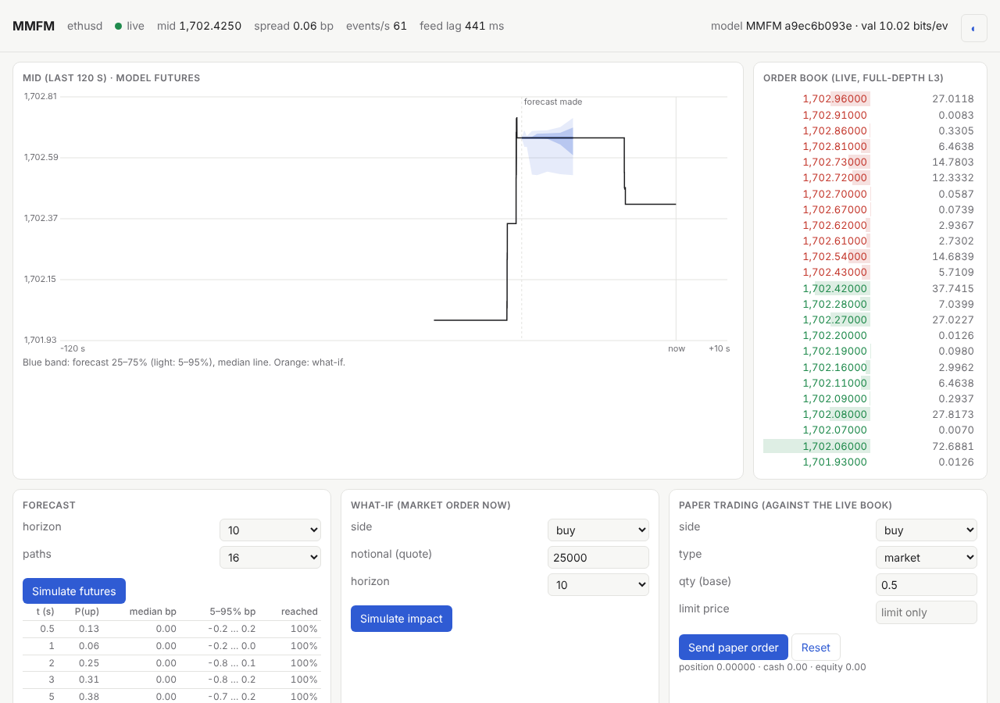

# MMFM — market-microstructure foundation model (pilot)

A state–event generative model of full-depth L3 order flow, trained on **real, public, live Bitstamp data**
and served through a minimal interface wired only to this model. It was built after the M3 audit
(`../m3repro`) and fixes each M3 flaw that the audit found:

| M3 flaw (audit) | MMFM design |
|---|---|
| VQ tokens are context-dependent (11.6-tick price drift) | Discrete, factorised tokens fit on train: act / side / bp-distance-from-touch / log-notional / Δt. The likelihood is exact. |
| The LOB is encoded once and goes stale | The state is recomputed from the verified book at **every event** (spread, imbalance, depth, returns, activity). |
| 10-level snapshot replay leaves phantom liquidity | Full-depth order-id reconstruction, **exact against every REST snapshot** (Jaccard 1.000). Cancels resolve against existing depth. |
| No rolling context in the release | A KV-cached rolling window, proven equal to the batch model. |
| Checkpoints were selected on test data | The test split is sealed and every access is logged. Selection uses val only. |

## Data (collect/recorder.py → data/l3.py → data/build.py)
* Bitstamp `live_orders` + `live_trades` for 8 pairs (≈750 events/s), plus order-id REST snapshots every 5 min.
* Each segment is anchored on a snapshot taken **after** the subscription; REST snapshots can be served stale by seconds.
* Bitstamp quirks found by verification and pinned by `tests/test_l3.py`:
  * trades on another channel arrive before the taker's `order_created`;
  * an aggressive `order_created` carries the full amount;
  * `order_changed` during a fill reports the execution price;
  * a delete message carries the unfilled amount;
  * trades can be stamped 1 ms after the order;
  * float-dust levels;
  * truncated gzip members.

## Evaluation & leakage protocol — `EVAL.md`, committed before training
* Splits by wall-clock time: 70 / 10 / 20, with a 10-min embargo.
* **linkusd is a held-out pair** (zero-shot).
* The test split is sealed: one unseal per (model hash, split, pre-registered metric), and each one is logged.
* Development data must fall inside the final train region (addendum 1). This is enforced in code.
* Baselines are fit on train with the identical tokenisation:
  * B0 zero-intelligence;
  * B1 Markov;
  * **B2 feature MLP**, the realistic bar. It gets the same tuning budget as MMFM.
* Metrics:
  * M1 next-event NLL (bits/event, block-bootstrap CIs);
  * M2 simulation realism (PIT, CRPS, W1, event rate);
  * M3 P(up);
  * M5 CPU latency / real-time factor;
  * M6 reconstruction fidelity.

## Harness (`pytest tests/`)
* Causality: AR model, features and KV cache.
* **Train/serve skew**: replayed recorded messages through the live handler give tokens and features identical to training.
* Seal and held-out isolation.
* AST scan: training code never names a sealed split.
* Tokenizer provenance.
* The incremental path equals the batch path.

The harness caught two of my own leaks before any training:
* a feature that used the *next* event's Δt;
* a live/batch skew in the definition of "state after the event".

## Interface — `serve/app.py` (+ `serve/index.html`, no external deps)
```bash
python3 -I serve/app.py --run runs/final_mmfm --pair ethusd --port 8765
```
Then open http://127.0.0.1:8765. It shows:
* the live L3 book and the feed lag;
* simulated futures (fan chart, P(up), real-time factor);
* a paired what-if for a market order;
* **paper trading** against the live displayed depth: market orders take VWAP across levels, and limit orders queue behind the displayed depth.

**No real orders can be sent.** Moving to real execution needs exchange keys, a risk layer and your explicit decision.



## Results
<!-- AUTO:results -->
(filled by `scripts/report.py` from `results/*.json` after the sealed run)
<!-- /AUTO:results -->

## Known limitations (measured, not hidden)
* **Compute**: CPU only, about 1M parameters, about 2.5 h of data. This is a pilot, not a foundation-scale model.
* **Real-time**: event-level rollouts cost about 8–21 ms per step for 16 paths. On fast pairs the simulator is
  slower than the market (dev: 0.3–0.5× real time), so live forecasts are limited to seconds.
* **Simulation calibration (dev)**: rollouts generate about 2× too many events, and the forecast fan is too narrow.
  Better next-event NLL does not imply calibrated multi-step paths.
* **Event extraction**: the model-event stream reproduces the order-id book exactly on slower pairs. On BTC/ETH/XRP
  a small residue accumulates: top-50 level match is 86–100% after 0.4–0.8M events. Model state always
  comes from the exact order-id book.
