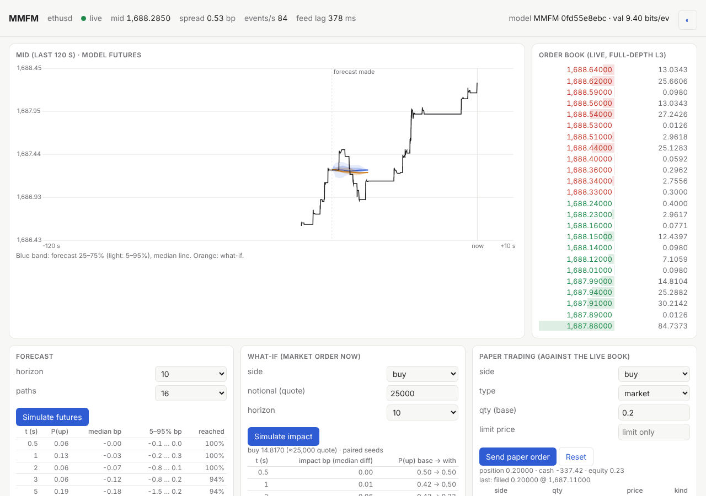

# MMFM — market-microstructure foundation model (pilot)

A state–event generative model of full-depth L3 order flow, trained on **real, public, live Bitstamp data**
and served through a minimal interface wired only to this model. It was built after the M3 audit
(`../m3repro`) and fixes each M3 flaw that the audit found:

| M3 flaw (audit) | MMFM design |
|---|---|
| VQ tokens are context-dependent (11.6-tick price drift) | Discrete, factorised tokens fit on train: act / side / bp-distance-from-touch / log-notional / Δt. The likelihood is exact. |
| The LOB is encoded once and goes stale | The state is recomputed from the verified book at **every event** (spread, imbalance, depth, returns, activity). |
| 10-level snapshot replay leaves phantom liquidity | Full-depth order-id reconstruction, **exact against every REST snapshot** (Jaccard 1.000). Cancels resolve against existing depth. |
| No rolling context in the release | A KV-cached rolling window, proven equal to the batch model. |
| Checkpoints were selected on test data | The test split is sealed and every access is logged. Selection uses val only. |

## Data (collect/recorder.py → data/l3.py → data/build.py)
* Bitstamp `live_orders` + `live_trades` for 8 pairs (≈750 events/s), plus order-id REST snapshots every 5 min.
* Each segment is anchored on a snapshot taken **after** the subscription; REST snapshots can be served stale by seconds.
* Bitstamp quirks found by verification and pinned by `tests/test_l3.py`:
  * trades on another channel arrive before the taker's `order_created`;
  * an aggressive `order_created` carries the full amount;
  * `order_changed` during a fill reports the execution price;
  * a delete message carries the unfilled amount;
  * trades can be stamped 1 ms after the order;
  * float-dust levels;
  * truncated gzip members.

## Evaluation & leakage protocol — `EVAL.md`, committed before training
* Splits by wall-clock time: 70 / 10 / 20, with a 10-min embargo.
* **linkusd is a held-out pair** (zero-shot).
* The test split is sealed: one unseal per (model hash, split, pre-registered metric), and each one is logged.
* Development data must fall inside the final train region (addendum 1). This is enforced in code.
* Baselines are fit on train with the identical tokenisation:
  * B0 zero-intelligence;
  * B1 Markov;
  * **B2 feature MLP**, the realistic bar. It gets the same tuning budget as MMFM.
* Metrics:
  * M1 next-event NLL (bits/event, block-bootstrap CIs);
  * M2 simulation realism (PIT, CRPS, W1, event rate);
  * M3 P(up);
  * M5 CPU latency / real-time factor;
  * M6 reconstruction fidelity.

## Harness (`pytest tests/`)
* Causality: AR model, features and KV cache.
* **Train/serve skew**: replayed recorded messages through the live handler give tokens and features identical to training.
* Seal and held-out isolation.
* AST scan: training code never names a sealed split.
* Tokenizer provenance.
* The incremental path equals the batch path.

The harness caught two of my own leaks before any training:
* a feature that used the *next* event's Δt;
* a live/batch skew in the definition of "state after the event".

## Interface — `serve/app.py` (+ `serve/index.html`, no external deps)
```bash
python3 -I serve/app.py --run runs/final_mmfm --pair ethusd --port 8765
```
Then open http://127.0.0.1:8765. It shows:
* the live L3 book and the feed lag;
* simulated futures (fan chart, P(up), real-time factor);
* a paired what-if for a market order;
* **paper trading** against the live displayed depth: market orders take VWAP across levels, and limit orders queue behind the displayed depth.

**No real orders can be sent.** Moving to real execution needs exchange keys, a risk layer and your explicit decision.



## Verdict (qualitative; all numbers are in the generated block below)
* **Next-event prediction (M1): MMFM wins on the sealed test** against every baseline, including a tuned feature MLP
  given the same budget. The 95% CI of the gap excludes 0, which meets the pre-registered criterion.
* **Zero-shot transfer to an unseen pair: MMFM loses** to the feature MLP, and every model is much worse than in-distribution.
  The "foundation" claim is **not** supported at this scale.
* **Simulation realism (M2): MMFM is not better than trivial count generators.** Multi-step paths are under-dispersed at
  5–10 s, and MMFM over-generates events. Better one-step likelihood did not give calibrated multi-step simulation.
  Exposure bias and the Δt head are the prime suspects.
* **Real-time (M5)**: live updates take milliseconds, but multi-path rollouts are slower than the market on BTC/ETH.
* **Data (M6)**: the reconstruction is exact against every verification snapshot.
* Process: six logged test unseals, each tied to an EVAL addendum committed before it.
  Addenda 4 and 5 fixed defects in *my* evaluation code after the first unseal; originals are kept.

## Results
<!-- AUTO:results -->
Frozen splits (wall clock): train 97 min · val 5 min · test 31 min · embargo 10 min · held-out pair `linkusd` · files hash `06cf74d60276`

**M6 data fidelity**: 227/227 snapshot verifications accepted (mean order-id Jaccard 1.0000); 6,436,369 model events in used segments.

**M1 val (selection split; 5-min block CIs)** — 39,879 scored events, 633 tiles (T=64)

| model | bits/event | 95% CI | Δ vs best baseline [95% CI] |
|---|---|---|---|
| B0_zero_intelligence | 15.161 | [15.111, 15.261] |  |
| B1_markov | 13.453 | [12.821, 14.219] |  |
| final_mmfm:MMFM | 9.383 | [8.330, 10.629] | -0.613 [-0.744, -0.527] vs final_b2 |
| final_b2:FeatMLP | 9.996 | [8.865, 11.322] |  |

**M1 TEST (sealed; CIs recomputed with 5-min blocks, addendum 4)** — 39,123 scored events, 621 tiles (T=64)

| model | bits/event | 95% CI | Δ vs best baseline [95% CI] |
|---|---|---|---|
| B0_zero_intelligence | 15.208 | [15.170, 15.255] |  |
| B1_markov | 13.666 | [13.305, 14.083] |  |
| final_mmfm:MMFM | 9.356 | [8.794, 10.046] | -0.612 [-0.682, -0.553] vs final_b2 |
| final_b2:FeatMLP | 9.968 | [9.369, 10.699] |  |

**M1 held-out pair linkusd, test period (zero-shot; addendum-4 CIs)** — 31,626 scored events, 502 tiles (T=64)

| model | bits/event | 95% CI | Δ vs best baseline [95% CI] |
|---|---|---|---|
| B0_zero_intelligence | 15.670 | [15.637, 15.703] |  |
| B1_markov | 15.371 | [15.303, 15.447] |  |
| final_mmfm:MMFM | 13.442 | [13.303, 13.569] | +0.299 [+0.271, +0.337] vs final_b2 |
| final_b2:FeatMLP | 13.143 | [13.018, 13.240] |  |

Original (defective, 20k-event-block) test CI for MMFM−B2: [-0.660, -0.564] — kept for the record.

**M2/M3 simulation realism, test** (addendum-5 metrics; start points = exact book checkpoints; lower CRPS/W1 better; PIT mean 0.5, central-80 coverage 0.8 and event-count ratio 1.0 ideal)

| pair | generator | h (s) | n | PIT mean | in central 80% | CRPS bp | W1 bp | Brier P(up) | event ratio |
|---|---|---|---|---|---|---|---|---|---|
| ethusd | MMFM | 1.0 | 15 | 0.39 | 0.87 | 0.110 | 0.099 | 0.047 | 2.08 |
| ethusd | MMFM | 5.0 | 15 | 0.38 | 0.40 | 1.225 | 1.038 | 0.217 | 1.54 |
| ethusd | MMFM | 10.0 | 15 | 0.27 | 0.27 | 0.974 | 0.879 | 0.220 | 2.21 |
| ethusd | B1 | 1.0 | 15 | 0.56 | 0.93 | 0.105 | 0.089 | 0.026 | 1.88 |
| ethusd | B1 | 5.0 | 15 | 0.40 | 0.27 | 1.248 | 1.100 | 0.175 | 1.10 |
| ethusd | B1 | 10.0 | 15 | 0.26 | 0.20 | 1.038 | 0.944 | 0.154 | 1.20 |
| ethusd | B0 | 1.0 | 15 | 0.54 | 0.93 | 0.147 | 0.183 | 0.214 | 1.89 |
| ethusd | B0 | 5.0 | 15 | 0.38 | 0.20 | 1.292 | 1.027 | 0.349 | 1.18 |
| ethusd | B0 | 10.0 | 15 | 0.26 | 0.20 | 1.086 | 0.919 | 0.281 | 1.20 |
| xrpusd | MMFM | 1.0 | 15 | 0.49 | 0.80 | 0.275 | 0.219 | 0.230 | 2.25 |
| xrpusd | MMFM | 5.0 | 15 | 0.59 | 0.67 | 0.788 | 0.331 | 0.325 | 2.16 |
| xrpusd | MMFM | 10.0 | 15 | 0.57 | 0.67 | 0.928 | 0.422 | 0.242 | 2.39 |
| xrpusd | B1 | 1.0 | 15 | 0.54 | 0.93 | 0.302 | 0.199 | 0.570 | 1.93 |
| xrpusd | B1 | 5.0 | 15 | 0.53 | 0.73 | 0.663 | 0.224 | 0.283 | 1.40 |
| xrpusd | B1 | 10.0 | 15 | 0.47 | 0.73 | 0.810 | 0.414 | 0.258 | 1.39 |
| xrpusd | B0 | 1.0 | 15 | 0.50 | 0.80 | 0.279 | 0.171 | 0.281 | 1.75 |
| xrpusd | B0 | 5.0 | 15 | 0.53 | 0.53 | 0.662 | 0.262 | 0.245 | 1.28 |
| xrpusd | B0 | 10.0 | 15 | 0.44 | 0.60 | 0.887 | 0.555 | 0.276 | 1.40 |
| dogeusd | MMFM | 1.0 | 15 | 0.60 | 0.87 | 0.102 | 0.290 | 0.102 | 10.88 |
| dogeusd | MMFM | 5.0 | 15 | 0.62 | 0.80 | 0.708 | 0.512 | 0.239 | 8.25 |
| dogeusd | MMFM | 10.0 | 15 | 0.68 | 0.60 | 1.096 | 0.778 | 0.311 | 9.91 |
| dogeusd | B1 | 1.0 | 15 | 0.60 | 1.00 | 0.181 | 0.394 | 0.078 | 12.92 |
| dogeusd | B1 | 5.0 | 15 | 0.52 | 0.87 | 0.487 | 0.394 | 0.205 | 5.26 |
| dogeusd | B1 | 10.0 | 15 | 0.62 | 0.53 | 0.909 | 0.537 | 0.204 | 4.63 |
| dogeusd | B0 | 1.0 | 15 | 0.66 | 1.00 | 0.210 | 0.472 | 0.203 | 16.08 |
| dogeusd | B0 | 5.0 | 15 | 0.45 | 0.87 | 0.610 | 0.397 | 0.172 | 6.77 |
| dogeusd | B0 | 10.0 | 15 | 0.47 | 0.67 | 1.061 | 0.409 | 0.243 | 5.94 |

**M5 real-time (CPU, 4 threads, 839,909 params)**: live update p50 2.05 ms, p99 4.26 ms.

| paths | ms/step | sim events/path/s | real-time factor vs median rate (per pair) |
|---|---|---|---|
| 1 | 2.9 | 342 | btceur 4.54×, btcusd 1.32×, dogeusd 7.73×, ethusd 2.21×, ltcusd 18.91×, solusd 3.89×, xrpusd 3.24× |
| 8 | 8.1 | 123 | btceur 1.63×, btcusd 0.47×, dogeusd 2.77×, ethusd 0.79×, ltcusd 6.79×, solusd 1.39×, xrpusd 1.16× |
| 16 | 12.3 | 81 | btceur 1.08×, btcusd 0.31×, dogeusd 1.83×, ethusd 0.52×, ltcusd 4.48×, solusd 0.92×, xrpusd 0.77× |
| 32 | 21.9 | 46 | btceur 0.61×, btcusd 0.18×, dogeusd 1.03×, ethusd 0.30×, ltcusd 2.52×, solusd 0.52×, xrpusd 0.43× |

Test access log (every unseal):

```
{"model_hash": "0fd55e8ebc15825c9f7c7cf6e2c16875837516e8090345b241a83a2959eb56d3", "split": "test", "purpose": "M1", "utc": "2026-11-26T06:12:27Z"}
{"model_hash": "0fd55e8ebc15825c9f7c7cf6e2c16875837516e8090345b241a83a2959eb56d3", "split": "heldout_test", "purpose": "M1", "utc": "2026-11-26T06:12:55Z"}
{"model_hash": "0fd55e8ebc15825c9f7c7cf6e2c16875837516e8090345b241a83a2959eb56d3", "split": "test", "purpose": "M2", "utc": "2026-11-26T06:13:59Z"}
{"model_hash": "0fd55e8ebc15825c9f7c7cf6e2c16875837516e8090345b241a83a2959eb56d3", "split": "test", "purpose": "M1-CI", "utc": "2026-11-26T06:54:26Z"}
{"model_hash": "0fd55e8ebc15825c9f7c7cf6e2c16875837516e8090345b241a83a2959eb56d3", "split": "heldout_test", "purpose": "M1-CI", "utc": "2026-11-26T06:54:54Z"}
{"model_hash": "0fd55e8ebc15825c9f7c7cf6e2c16875837516e8090345b241a83a2959eb56d3", "split": "test", "purpose": "M2-fix", "utc": "2026-11-26T06:55:42Z"}
```
<!-- /AUTO:results -->

## Known limitations (measured, not hidden)
* **Compute**: CPU only, about 1M parameters, about 2.5 h of data. This is a pilot, not a foundation-scale model.
* **Real-time**: event-level rollouts cost about 8–21 ms per step for 16 paths. On fast pairs the simulator is
  slower than the market (dev: 0.3–0.5× real time), so live forecasts are limited to seconds.
* **Simulation calibration (dev)**: rollouts generate about 2× too many events, and the forecast fan is too narrow.
  Better next-event NLL does not imply calibrated multi-step paths.
* **Event extraction**: the model-event stream reproduces the order-id book exactly on slower pairs. On BTC/ETH/XRP
  a small residue accumulates: top-50 level match is 86–100% after 0.4–0.8M events. Model state always
  comes from the exact order-id book.
